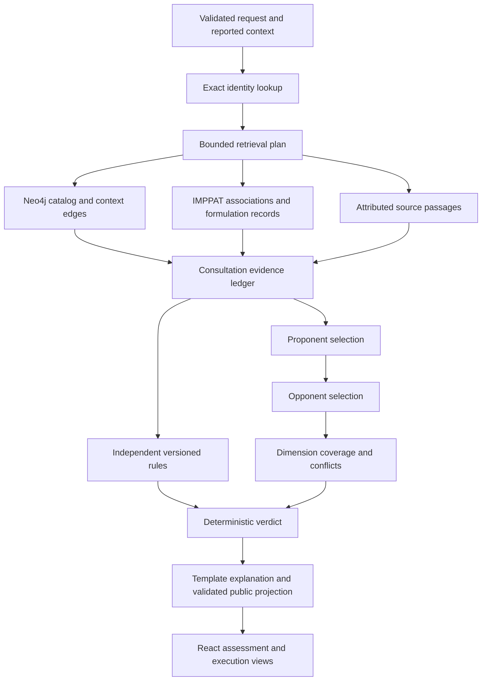

# VedaAI evidence-first consultations

## Architecture and boundaries

Express serves the React/Vite client and validates bounded JSON or multipart requests. The prior consultation pipeline used five Gemini calls, Neo4j traversal, cosine ranking of 25 graph summaries and a Judge-generated safety verdict. A second server function could change that verdict. The current text and in-domain image consultation paths use one fixed LangGraph workflow. The previous graph remains accessible to the historical ablation runner. The image classification and product-label inspection services still use their own extraction contracts. A catalog match identifies a label ingredient. An ingredient without a graph flag has insufficient safety evidence.



## Retrieval and storage

- Botanical identification uses token-boundary, longest exact alias matches from the seed catalog and IMPPAT plant metadata. Ambiguous aliases (such as `Amla` and `Brahmi` matching multiple IMPPAT species) enter review rather than resolving arbitrarily. The plan binds at most 12 identities. Unrecognized free text can still yield reported-use or passage results. Entity recognition does not infer medical history, seasons, or conditions from prose.
- The legacy graph supplies canonical `catalog_identity`, seasonal `CONTRAINDICATED_IN` targets, context-matched `PACIFIES`/`AGGRAVATES` relationships, matching condition `ASSOCIATED_WITH` edges, and matching season `DOMINANT_IN` edges through fixed, parameterized, time-limited read transactions. The project origin (`VedaAI project ontology`, `sourceId: null`) and `unverified` classification remain visible; clinical significance lacks expert validation.
- Three separate TSV readers preserve original field names. The cached table index returns up to 24 reported-use rows and up to eight formulation rows for formulation, ingredient or plant-part questions. Matching uses exact lowercase English terms from the query without synonym expansion. Switching `IMPPAT_RETRIEVAL_BACKEND=neo4j` queries `:ImppatPlant-[:HAS_REPORTED_USE]->:ImppatUse` (note: `:ImppatFormulationRecord` is not yet queried on the Neo4j backend and live post-import retrieval remains untested). A match expresses a reported association only.
- The historical vector file is about 1 MB. A local measurement loaded its 25 chunks in 21.6 ms and ranked them in 3.3 ms on average across 100 cached passes using a stored query vector. This excludes provider latency. Those synthetic graph summaries supply no primary-source quotations. No measured workload here requires a separate vector service.
- The document command accepts a UTF-8 text original up to 256 KiB and a strict JSON manifest. Required fields are `title` and `kind` (`classical` or `research`). Optional fields are `author`, `edition`, `section`, `verse`, `translation` and a positive integer `page`. Metadata applies to the whole input. For varying locations submit one attributable section per input. Original authorship, edition and translation require curator verification.
- Ingestion preserves the exact original bytes under their digest in `data/source_documents`. It decodes text, records UTF-16 offsets, splits at 1,200 code units, generates Gemini document embeddings in batches and publishes a separate immutable JSON index through a temporary file and hard link. Re-running the same original and manifest reuses the index. Readiness requires a complete index. Orphaned originals after a failed embedding request are safe to retry.
- Search embeds the query, validates the source digest, indexed offsets, embedding dimensions and model identity on first load, and returns the top five cosine matches. The cache assumes immutable locally controlled files. The reader supports up to 64 indexes. Relevance measures similarity only. Raw PDF, scanned-page OCR, persistent multi-process indexing and a licensed classical or clinical corpus are outstanding. Import reviewed text originals before evaluating document retrieval quality.

## Evidence, coverage and verdict contracts

`engine/evidence.js` defines the runtime Zod schemas. Each record carries a consultation-scoped content identifier, retrieval time, kind, method, excerpt, source identifier, title and locator, optional structured triple, relevance, attribution metadata and verification status. Document entries include a document and chunk identifier. Source locations can be null. The statuses distinguish traceable source material, missing provenance, patient self-report and unverified interpretation. Traceability establishes where text came from. It makes no claim about the accuracy of the source. Opposing records survive normalization. The DTO rejects missing references and records belonging to a different consultation.

The Proponent may select up to five traceable record IDs. The Opponent may select up to five retrieved records for review. Model replies with additional fields, arbitrary claims or unknown IDs fail validation. Application code assigns finding text and category. The model cannot insert a recommendation into public prose. Directly opposing structured predicates about the same subject and object produce an explicit conflict. Free-text contradiction detection remains limited to specialist review. The template explanation reads the computed verdict.

Each coverage row records its dimension, status, evidence references, findings, missing information, reason and review requirement. Intake coverage records the presence of a report. Separate rows account for interactions, contraindications, formulation/dose, special populations, allergen suitability, source availability, unresolved identities, review findings, and stage failures. An omitted medication list leaves history unassessed. An explicitly submitted empty list identifies no reported current medication. The browser omits blank lists because an untouched form provides no negative medical history.

Policy version 1.0 applies this precedence:

1. An applicable approved blocking rule produces `blocked`.
2. A review rule, unresolved identity, conflicting evidence or specialist review finding produces `expert_review_required`. Triggered restrictions remain in the record.
3. An applicable approved restriction produces `restricted`.
4. Remaining consultations produce `insufficient_evidence`. The contract reserves `permitted`; the current policy never issues a treatment clearance.

The clinical rule registry ships empty (`registry = Object.freeze([])`). Its typed rule form requires a version, source, approval status, applicable herb, exact patient field/value, population, outcome and description. Approved rules match either graph `catalog_identity` or source-traceable table associations so critical restrictions still execute if Neo4j is unavailable. Pending rules cannot execute. Test-only approvals exercise blocking and restriction. The two active engineering guards (`legacy-season-edge` and `legacy-context-review`) require expert review only when `CONTRAINDICATED_IN` matches the patient's season (supporting canonical Sanskrit/English aliases) or when `AGGRAVATES` matches reported Prakriti, an `ASSOCIATED_WITH` condition edge, or a `DOMINANT_IN` season edge, preserving all supporting evidence IDs. Missing patient context neither triggers a false patient-specific match nor grants clearance. Qualified experts must supply approved scope-specific rules, coverage criteria and matched primary evidence before enabling an affirmative treatment category.

The verdict records its ID, consultation ID, version, category, triggered rule versions and evidence IDs, coverage, review requirement, explanation, missing information and timestamp. The engine freezes the computed result. Replay uses the saved inputs and original timestamp. New consultations have new identities. There is no safety score. The API retains the historical nullable confidence field.

## API and client

`POST /api/chat` accepts `query` and the optional patient fields in `lib/security.js`. For example, a JSON request can contain `{"query":"Ginger for nausea","season":"Grishma"}`. The response contains `consultationId`, `durationMs`, `confidenceScore` and `result`. Inside `result`, `assessment` contains only `verdict`, `ledger`, `findings` and public stage names/statuses, with patient-facing strings and bare Aura instance IDs scrubbed by `scrubInternalText()`. Compatibility fields include `final_verdict`, `summary_message`, `evaluated_herbs`, `missing_coverage`, `safety_warnings` and `disclaimer`. A completed HTTP request can report an incomplete clinical assessment. Source failures remain visible independently. A graph outage need not discard a table or approved-rule result.

`POST /api/consult-with-image` first checks the image and ingredient identities. In-domain results use the same consultation policy (and flag unverified herbal formulations explicitly when zero catalog herbs match). A completed out-of-domain classification and unavailable image analysis remain distinct. `/api/scan` and `/api/label-audit` describe extraction, catalog matches and legacy review flags without ledger-backed evidence. An image-extraction summary provides no clinical clearance. `POST /api/follow-up` accepts a consultation UUID and question with the originating response's follow-up bearer credential. It resolves the original verdict, evidence, patient context and up to eight prior server-stored turns. Missing, unauthorized or expired consultations return insufficient context. `/api/feedback` records timestamped feedback enums only.

The assessment view shows backend verdicts, sources, excerpts, source locations, classification, verification and dimensional coverage. The transparency view uses stages returned by the workflow. `ProductLabelAnalyzer` filters live non-flagged rows (`INSUFFICIENT_EVIDENCE`) under `"No Flag"`; `HealthProfileScreen` uses unselected placeholder options (`""`) for optional demographics. The graph and herb explorers read the live Neo4j catalog. The drug-herb checker reports insufficient evidence. Profiles and consultation history start empty and last only for the browser page session. Account and admin views are demonstrations. See [Phase 0B remediation](PHASE_0B.md) for the API boundaries and patient persistence design.

## Additive migration and rollback

Read-only inspection of the configured database found Herb, Condition, Dosha and Season labels; AGGRAVATES, PACIFIES, ASSOCIATED_WITH, DOMINANT_IN, TREATS and CONTRAINDICATED_IN relationships; five range and two lookup indexes; and zero uniqueness constraints. No live schema or data writes were performed.

The import targets separate ImppatPlant, ImppatUse and ImppatFormulationRecord labels. It creates uniqueness constraints, a botanical lookup index and a distinct HAS_REPORTED_USE edge per release digest and row. Original metadata fields, plant part, formulation identifiers and references are preserved. Formulation ingredients remain source fields; there is no heuristic join to a plant. It validates plant IDs before writing and uses retryable transactions of 400 rows. A partially completed import can resume by rerunning the same files. Replacing a TSV represents a new release and may introduce additional historical associations. Pin one release for a deployment.

```powershell
node scripts/import_imppat.js
node scripts/import_imppat.js --check-db
# Apply to the intended database after reviewing the target and the schema above.
node scripts/import_imppat.js --apply
```

Dry-run totals were 4,154 plant records, 94,261 use associations and 541 formulation records. Neo4j successfully planned all three batch statements with EXPLAIN. Applying the DDL, ingesting into a clone, repeating the import and checking post-import counts remain operational verification steps. Live service operation uses the TSV index by default. After importing, `IMPPAT_RETRIEVAL_BACKEND=neo4j` selects database-backed reported-use lookup. Use `tsv` to revert reads without deleting any records. Back up a target before applying a new release. Restore a pre-migration backup to a separate instance if physical rollback is required. The old seed bootstrap now requires an empty graph.

## Run and verify

Use Node 22 and the lockfiles. Set `NEO4J_URI`, `NEO4J_USERNAME`, `NEO4J_PASSWORD` and `GEMINI_API_KEY` locally. See `.env.example` for origin, proxy and request-capacity settings.

```powershell
npm.cmd ci
npm.cmd --prefix client ci
npm.cmd run build:web
npm.cmd start
# Local application at http://localhost:4000
# In another terminal
npm.cmd run test:evidence
npm.cmd run test:remediation
npm.cmd run test:security
npm.cmd test
npm.cmd --prefix client run lint
# Ingest an operator-supplied source and manifest
node engine/documents.js source.txt metadata.json
```

The stratified suite defines expected categories before invoking LangGraph. It exercises positive source retrieval, synthetic critical blocks, restrictions, absent patient data, missing interaction evidence, structured conflicts, partial failures and hostile or malformed model output, plus 7 policy regression tests verifying context-matched `AGGRAVATES`, non-matching `AGGRAVATES`, missing patient context, `PACIFIES`/`AGGRAVATES` conflicts, matching/non-matching seasons, and offline approved rules. Separate tests exercise the HTTP and follow-up routes, document preservation, ranking, ledger identity and DTO validation. In the verified 14-case stratified run (`meanMs: 51`), all categories matched, all six finding references resolved, both expected critical flags and all three targeted gaps were detected, and zero injected claims leaked.

The legacy local suite still exercises its own fixed examples. Its Ginger example produces an unsafe ruling. The new live integration test for the seasonal Ginger question expects expert review because the project-authored edge has no documented clinical approval. These results establish a policy change. The historical ablation suite (`scripts/run_ablation_benchmark.js`) targets the legacy pipeline (`buildLegacyPipeline`) and its old confidence values cannot be compared as clinical accuracy. A meaningful corpus-wide retrieval benchmark and clinical comparison require independently annotated queries, primary documents and blinded expert outcomes.

## Implementation inventory

Verification after final edits passed all 26 evidence/policy/workflow tests (`npm.cmd run test:evidence`), 13 Phase 0A backend regressions and one React rendering regression (`npm.cmd run test:remediation`), 10 security/integration tests including bare Aura ID scrubbing, unverified image consult, and live Neo4j/Gemini integration (`npm.cmd run test:security`), and 36 historical local checks (`npm.cmd test`). `npm.cmd ci` at root, `npm.cmd run build:web` (`1.51s`), TypeScript `tsc --noEmit`, and `oxlint` (`0` warnings/errors on 24 files) all passed; `npm.cmd --prefix client ci` failed with Windows `EPERM (-4048)` unlinking `.node` binaries held by a pre-existing external `CodexSandboxOffline` Vite process (`PID 7216`), so client dependencies were restored cleanly via `npm.cmd --prefix client install --no-save` without altering `client/package-lock.json`.

New modules are `engine/assessment_workflow.js`, `engine/evidence.js`, `engine/policy.js`, `engine/rule_registry.js`, `engine/structured_sources.js`, `engine/documents.js`, `scripts/import_imppat.js` and `scripts/test_evidence.js`. This guide is also new.

Integration changes cover `server.js`, `engine/pipeline.js`, `engine/followup_agent.js`, `engine/cypher_builder.js`, `engine/llm_client.js`, `engine/vector_store.js`, `engine/vision_agent.js`, `engine/label_audit.js`, `lib/neo4j_config.js`, `lib/response_sanitizer.js`, both consultation CLIs, the seed Cypher and its generator/runner, the historical ablation runner, the security suite, package scripts, environment example and README. Client changes cover App, consultation types and mapping, Consultation, AI Assessment, Agent Transparency, Product Label Analyzer, Health Profile and the rendering regression test. The local production build refreshes `public/index.html`, its asset manifest and managed bundles. Prior working-tree changes are preserved.
