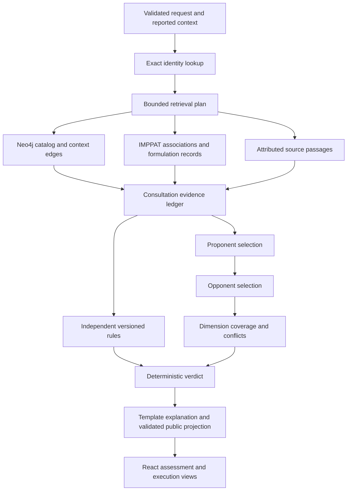

# VedaAI evidence-first consultations

## Architecture and boundaries

Express serves the React/Vite client and validates bounded JSON or multipart requests. The prior consultation pipeline used five Gemini calls, Neo4j traversal, cosine ranking of 25 graph summaries and a Judge-generated safety verdict. A second server function could change that verdict. The current text and in-domain image consultation paths use one fixed LangGraph workflow. The previous graph remains accessible to the historical ablation runner. The image classification and product-label inspection services still use their own extraction contracts. A catalog match identifies a label ingredient. An ingredient without a graph flag has insufficient safety evidence.



## Retrieval and storage

- Botanical identification uses token-boundary, longest exact alias matches from the seed catalog and IMPPAT plant metadata. Ambiguous aliases enter review. The plan binds at most 12 identities. Unrecognized free text can still yield reported-use or passage results. Entity recognition does not infer medical history from prose.
- The legacy graph supplies identity, seasonal caution and context-matched dosha relationships through fixed, parameterized, time-limited read transactions. The distinctive botanical key and project origin remain visible. The clinical significance of these edges lacks expert validation.
- Three separate TSV readers preserve original field names. The cached table index returns up to 24 reported-use rows and up to eight formulation rows for formulation, ingredient or plant-part questions. A citation contains the file title, file SHA-256 and physical line. Each row can be located even when two associations connect the same endpoints. Matching uses English terms and aliases. A match expresses a reported association only.
- The historical vector file is about 1 MB. A local measurement loaded its 25 chunks in 21.6 ms and ranked them in 3.3 ms on average across 100 cached passes using a stored query vector. This excludes provider latency. Those synthetic graph summaries supply no primary-source quotations. No measured workload here requires a separate vector service.
- The document command accepts a UTF-8 text original up to 256 KiB and a strict JSON manifest. Required fields are `title` and `kind` (`classical` or `research`). Optional fields are `author`, `edition`, `section`, `verse`, `translation` and a positive integer `page`. Metadata applies to the whole input. For varying locations submit one attributable section per input. Original authorship, edition and translation require curator verification.
- Ingestion preserves the exact original bytes under their digest in `data/source_documents`. It decodes text, records UTF-16 offsets, splits at 1,200 code units, generates Gemini document embeddings in batches and publishes a separate immutable JSON index through a temporary file and hard link. Re-running the same original and manifest reuses the index. Readiness requires a complete index. Orphaned originals after a failed embedding request are safe to retry.
- Search embeds the query, validates the source digest, indexed offsets, embedding dimensions and model identity on first load, and returns the top five cosine matches. The cache assumes immutable locally controlled files. The reader supports up to 64 indexes. Relevance measures similarity only. Raw PDF, scanned-page OCR, persistent multi-process indexing and a licensed classical or clinical corpus are outstanding. Import reviewed text originals before evaluating document retrieval quality.

## Evidence, coverage and verdict contracts

`engine/evidence.js` defines the runtime Zod schemas. Each record carries a consultation-scoped content identifier, retrieval time, kind, method, excerpt, source identifier, title and locator, optional structured triple, relevance, attribution metadata and verification status. Document entries include a document and chunk identifier. Source locations can be null. The statuses distinguish traceable source material, missing provenance, patient self-report and unverified interpretation. Traceability establishes where text came from. It makes no claim about the accuracy of the source. Opposing records survive normalization. The DTO rejects missing references and records belonging to a different consultation.

The Proponent may select up to five traceable record IDs. The Opponent may select up to five retrieved records for review. Model replies with additional fields, arbitrary claims or unknown IDs fail validation. Application code assigns finding text and category. The model cannot insert a recommendation into public prose. Directly opposing structured predicates about the same subject and object produce an explicit conflict. Free-text contradiction detection remains limited to specialist review. The template explanation reads the computed verdict.

Each coverage row records its dimension, status, evidence references, findings, missing information, reason and review requirement. Intake coverage records the presence of a report. Separate rows account for interactions, contraindications, formulation/dose, special populations, allergen suitability, source availability, unresolved identities, review findings, and stage failures. An omitted medication list leaves history unassessed. An explicitly submitted empty list identifies no reported current medication. The browser omits blank lists because an untouched form provides no negative medical history.

Policy version 1.0 applies this precedence:

1. An applicable approved blocking rule produces `blocked`.
2. A review rule, unresolved identity, conflicting evidence or specialist review finding produces `expert_review_required`. Triggered restrictions remain in the record.
3. An applicable approved restriction produces `restricted`.
4. Remaining consultations produce `insufficient_evidence`. The contract reserves `permitted`; the current policy never issues a treatment clearance.

The clinical rule registry ships empty. Its typed rule form requires a version, source, approval status, applicable herb, exact patient field/value, population, outcome and description. Pending rules cannot execute. Test-only approvals exercise blocking and restriction. The two active engineering rules refer matching legacy seasonal and aggravation edges for review. Those rules authorize review only. Qualified experts must supply approved scope-specific rules, coverage criteria and matched primary evidence before enabling an affirmative treatment category.

The verdict records its ID, consultation ID, version, category, triggered rule versions and evidence IDs, coverage, review requirement, explanation, missing information and timestamp. The engine freezes the computed result. Replay uses the saved inputs and original timestamp. New consultations have new identities. There is no safety score. The API retains the historical nullable confidence field.

## API and client

`POST /api/chat` accepts `query` and the optional patient fields in `lib/security.js`. For example, a JSON request can contain `{"query":"Ginger for nausea","season":"Grishma"}`. The response contains `consultationId`, `durationMs`, `confidenceScore` and `result`. Inside `result`, `assessment` contains only `verdict`, `ledger`, `findings` and public stage names/statuses. Compatibility fields include `final_verdict`, `summary_message`, `evaluated_herbs`, `missing_coverage`, `safety_warnings` and `disclaimer`. A completed HTTP request can report an incomplete clinical assessment. Source failures remain visible independently. A graph outage need not discard a table result.

`POST /api/consult-with-image` first checks the image and ingredient identities. In-domain results use the same consultation policy. A completed out-of-domain classification and unavailable image analysis remain distinct. `/api/scan` and `/api/label-audit` describe extraction, catalog matches and legacy review flags. An image-extraction summary provides no clinical clearance. `POST /api/follow-up` accepts a consultation UUID and question, resolves the originating server record and preserves its restrictions. Expired or unknown IDs return insufficient context.

The assessment view shows backend verdicts, sources, excerpts, source locations, classification, verification and dimensional coverage. The transparency view uses stages returned by the workflow. Sample screens remain labelled. The live profile starts blank. Request budgets, signature validation, CORS, sanitized errors and trace expiry continue to use the existing Phase 0A middleware. UUIDs function as bearer references. Authenticated patient isolation, distributed retention/rate limiting, production browser navigation and load testing remain outstanding.

## Additive migration and rollback

Read-only inspection of the configured database found Herb, Condition, Dosha and Season labels; AGGRAVATES, PACIFIES, ASSOCIATED_WITH, DOMINANT_IN, TREATS and CONTRAINDICATED_IN relationships; five range and two lookup indexes; and zero uniqueness constraints. No live schema or data writes were performed.

The import targets separate ImppatPlant, ImppatUse and ImppatFormulationRecord labels. It creates uniqueness constraints, a botanical lookup index and a distinct HAS_REPORTED_USE edge per release digest and row. Original metadata fields, plant part, formulation identifiers and references are preserved. Formulation ingredients remain source fields; there is no heuristic join to a plant. It validates plant IDs before writing and uses retryable transactions of 400 rows. A partially completed import can resume by rerunning the same files. Replacing a TSV represents a new release and may introduce additional historical associations. Pin one release for a deployment.

```powershell
node scripts/import_imppat.js
node scripts/import_imppat.js --check-db
# Apply to the intended database after reviewing the target and the schema above.
node scripts/import_imppat.js --apply
```

Dry-run totals were 4,154 plant records, 94,261 use associations and 541 formulation records. Neo4j successfully planned all three batch statements with EXPLAIN. Applying the DDL, ingesting into a clone, repeating the import and checking post-import counts remain operational verification steps. Live service operation uses the TSV index by default. After importing, `IMPPAT_RETRIEVAL_BACKEND=neo4j` selects database-backed reported-use lookup. Use `tsv` to revert reads without deleting any records. Back up a target before applying a new release. Restore a pre-migration backup to a separate instance if physical rollback is required. The old seed bootstrap now requires an empty graph.

## Run and verify

Use Node 22 and the lockfiles. Set `NEO4J_URI`, `NEO4J_USERNAME`, `NEO4J_PASSWORD` and `GEMINI_API_KEY` locally. See `.env.example` for origin, proxy and request-capacity settings.

```powershell
npm.cmd ci
npm.cmd --prefix client ci
npm.cmd run build:web
npm.cmd start
# Local application at http://localhost:4000
# In another terminal
npm.cmd run test:evidence
npm.cmd run test:remediation
npm.cmd run test:security
npm.cmd test
npm.cmd --prefix client run lint
# Ingest an operator-supplied source and manifest
node engine/documents.js source.txt metadata.json
```

The stratified suite defines expected categories before invoking LangGraph. It exercises positive source retrieval, synthetic critical blocks, restrictions, absent patient data, missing interaction evidence, structured conflicts, partial failures and hostile or malformed model output. Separate tests exercise the actual HTTP and follow-up routes, document preservation, ranking, ledger identity and DTO validation. The fixture evaluation counts incorrect permits/blocks, reference validity, injected unsupported claims, expected rule hits, expected gaps and local elapsed time. It includes one real TSV association retrieval. In a 14-case run, all categories matched, all six finding references resolved, both expected critical flags and all three targeted gaps were detected, and zero injected claims leaked. The expected IMPPAT row was returned. Mean local workflow time was 114 ms in that run, including a cold catalog read and mocked external services.

The legacy local suite still exercises its own fixed examples. Its Ginger example produces an unsafe ruling. The new live integration test for the seasonal Ginger question expects expert review because the project-authored edge has no documented clinical approval. These results establish a policy change. The historical ablation suite uses a different target definition and its old confidence values cannot be compared as clinical accuracy. A meaningful corpus-wide retrieval benchmark and clinical comparison require independently annotated queries, primary documents and blinded expert outcomes.

## Implementation inventory

Verification on the local working tree passed 18 evidence/workflow tests, 13 Phase 0A backend regressions, one React rendering regression, 10 security/integration tests including the configured live services, and 36 historical local checks. The security suite initially failed its live readiness assertion under network isolation and passed with network access. Client lint, TypeScript compilation and the production Vite build passed. The build refreshed local assets only.

New modules are `engine/assessment_workflow.js`, `engine/evidence.js`, `engine/policy.js`, `engine/rule_registry.js`, `engine/structured_sources.js`, `engine/documents.js`, `scripts/import_imppat.js` and `scripts/test_evidence.js`. This guide is also new.

Integration changes cover `server.js`, `engine/pipeline.js`, `engine/followup_agent.js`, `engine/cypher_builder.js`, `engine/llm_client.js`, `engine/vector_store.js`, `engine/vision_agent.js`, `engine/label_audit.js`, `lib/neo4j_config.js`, `lib/response_sanitizer.js`, both consultation CLIs, the seed Cypher and its generator/runner, the historical ablation runner, the security suite, package scripts, environment example and README. Client changes cover App, consultation types and mapping, Consultation, AI Assessment, Agent Transparency and the rendering regression test. The local production build refreshes `public/index.html`, its asset manifest and managed bundles. Prior working-tree changes are preserved.
